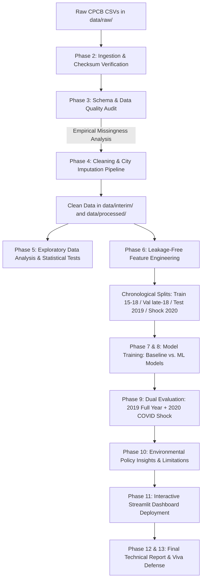

# Analytical Workflow & Application Flow (APP_FLOW.md)
## India Air Quality Intelligence: Exploratory Analysis, Pollution Pattern Discovery and AQI Forecasting

- **Document Version:** 1.1.0 (Audited & Methodologically Revised)
- **Document History:**
  - `v1.0.0` (2026-10-24): Initial workflow specification.
  - `v1.1.0` (2026-10-24): Revised following planning audit. Updated analytical pipeline to execute dual-test evaluation (2019 representative annual test + 2020 COVID shock analysis); emphasized offline historical forecasting in Streamlit user flows.
- **Perspective:** Dual Pathway — Data Scientist Research Pipeline & Interactive User Journey
- **Status:** Approved Post-Audit Baseline

---

### 1. Dual Flow Overview

The project comprises two synchronized flows:
1. **Analyst Workflow (Batch Analytical Pipeline):** The deterministic, code-driven lifecycle executing ingestion, validation, cleaning, exploration, feature creation, model fitting, and metric generation.
2. **User Application Flow (Interactive Streamlit Dashboard):** The researcher, policy-maker, and student interface allowing exploratory data analysis, inspection of model benchmarks, and scenario-based AQI forecasting.

---

### 2. End-to-End Analyst Lifecycle Workflow



---

### 3. Detailed Step-by-Step Analytical Pipeline

#### Flow 1: Ingestion & Schema Verification
- **Input:** `city_day.csv`, `city_hour.csv`, `station_day.csv`, `station_hour.csv`, `stations.csv` placed in `data/raw/`.
- **Process:** Calculate SHA-256 checksums, verify expected column names, cast datetimes, validate non-negative physical values.
- **Output:** Raw file audit logs and `data/interim/quality_audit_summary.json`.

#### Flow 2: Data Preprocessing & Cleaning Pipeline
- **Input:** Raw validated datasets.
- **Process:**
  1. Enforce continuous daily calendar per city to expose missing days.
  2. Implement candidate bounded forward-fill ($\le 2$ days) and evaluate impact on dataset size.
  3. Filter cities based on active monitoring completeness (calibrated in Phase 3).
  4. Preserve physical pollution spikes in training and test sets.
- **Output:** `data/interim/city_day_cleaned.parquet` and `data/processed/city_day_model_ready.parquet`.

#### Flow 3: Exploratory Data Analysis (EDA) Pipeline
- **Input:** Cleaned dataset.
- **Process:**
  1. Compute univariate distributions (mean, median, IQR, 95th percentile) for all pollutants.
  2. Perform seasonal time-series decomposition (Winter, Pre-Monsoon, Monsoon, Post-Monsoon).
  3. Calculate chemical precursor correlation matrices ($PM_{2.5}, PM_{10}, NO_2, SO_2, CO, O_3$).
  4. Quantify COVID-19 lockdown shock (March–May 2020 vs. historical March–May 2015–2019 baseline).
- **Output:** High-resolution figures in `reports/figures/` and summary tables in `reports/tables/`.

#### Flow 4: Feature Engineering & Leakage Protection Pipeline
- **Input:** Cleaned daily time-series.
- **Process:**
  1. Extract calendar features (`day_of_week`, `month`, `day_of_year`, `is_weekend`).
  2. Compute autoregressive lags ($AQI_{t-1}, AQI_{t-2}, AQI_{t-3}, AQI_{t-7}$) grouped by city.
  3. Compute backward-looking rolling statistics (7-day and 14-day rolling mean, std, max) shifted by 1 day.
  4. Generate primary target ($y_{reg} = AQI_{t+1}$) and secondary target ($y_{clf} = \text{Bucket}(AQI_{t+1})$).
  5. Partition chronologically: Train (2015–mid 2018), Val (mid–end 2018), Test (2019 full year), Stress Test (2020).
- **Output:** Train, Validation, Test, and Stress-Test feature matrices in `data/processed/`.

#### Flow 5: Model Training & Experiment Tracking
- **Input:** Processed feature matrices.
- **Process:**
  1. Fit Naive Persistence Baseline ($\hat{y}_{t+1} = AQI_t$).
  2. Fit Ridge Regression with TimeSeriesSplit cross-validation on Training fold.
  3. Fit Random Forest Regressor and HistGradientBoostingRegressor on Training fold.
  4. Tune hyperparameters on Validation fold.
  5. Fit optional secondary classifier for ablation comparison.
- **Output:** Serialized model artifacts in `models/`.

#### Flow 6: Dual Evaluation & Residual Diagnostics
- **Input:** Trained model artifacts, 2019 Test Matrix, and 2020 Shock Matrix.
- **Process:**
  1. Compute primary out-of-time test metrics on 2019 (MAE, RMSE, $R^2$, MAPE).
  2. Map continuous predictions into CPCB buckets to compute Confusion Matrix, Macro F1, and Balanced Accuracy.
  3. Compute stress-test metrics on 2020 lockdown period to quantify performance degradation under structural shock.
  4. Perform residual diagnostics: plot $e_t = y_t - \hat{y}_t$ over time, inspect error across AQI severity tiers and cities.
- **Output:** Scorecards in `reports/metrics/` and diagnostic plots in `reports/figures/`.

---

### 4. Interactive Application User Flow (Streamlit Dashboard)

#### 4.1 Navigation Hierarchy & Page Routing

```
Streamlit Application (app/main.py)
│
├── Page 1: 📊 Executive Overview & Objectives
│   ├── KPI Header (Total Observations, Monitored Cities, Date Range, Status)
│   ├── Project Problem Statement & Academic Alignment
│   └── CPCB AQI Standard Category Explanations
│
├── Page 2: 🔍 Data Quality & Sensor Health
│   ├── File Inventory & Checksum Status
│   ├── Missingness Heatmap (City vs. Year)
│   └── Continuity & Imputation Audit
│
├── Page 3: 📈 Exploratory Pollution Intelligence
│   ├── Multi-City AQI Trend Comparison
│   ├── Seasonal Pollution Decompositions
│   ├── Chemical Species Correlation Matrix
│   └── COVID-19 Lockdown Shock Analysis
│
├── Page 4: 🤖 Model Benchmark & Evaluation
│   ├── Out-of-Time Scorecard (2019 Primary Test: Baseline vs. Ridge vs. RF vs. HistGB)
│   ├── COVID-19 Lockdown Stress-Test Comparison (2020 Shock Analysis)
│   ├── CPCB AQI Bucket Confusion Matrix & Class Diagnostics
│   ├── Residual Error Analysis & Heteroscedasticity Plots
│   └── Feature Importance Rankings
│
├── Page 5: 🔮 Offline Next-Day AQI Forecaster (Scenario Sandbox)
│   ├── City Selection & Historical Context Visualizer
│   ├── What-If Scenario Slider (Adjust Recent Lag Pollutants)
│   ├── Model Forecast Display with Confidence Range
│   └── Clear Operational Disclaimer Banner
│
└── Page 6: 📋 Policy Insights & Recommendations
    ├── Evidence-to-Action Matrix (Researchers, Planners, Public Health)
    ├── Research Limitations & Future Work
    └── Student Viva Defense Q&A Cheatsheet
```

#### 4.2 State Transitions & Disclaimer Policy
- **Offline Sandbox Banner:** Every prediction view prominently displays: *"Offline forecasting research prototype trained on historical CPCB 2015–2020 observations. Not for operational life-safety advisories."*
- **Empty & Error States:** Graceful fallbacks when a selected city lacks sensor coverage for specific historical dates.
